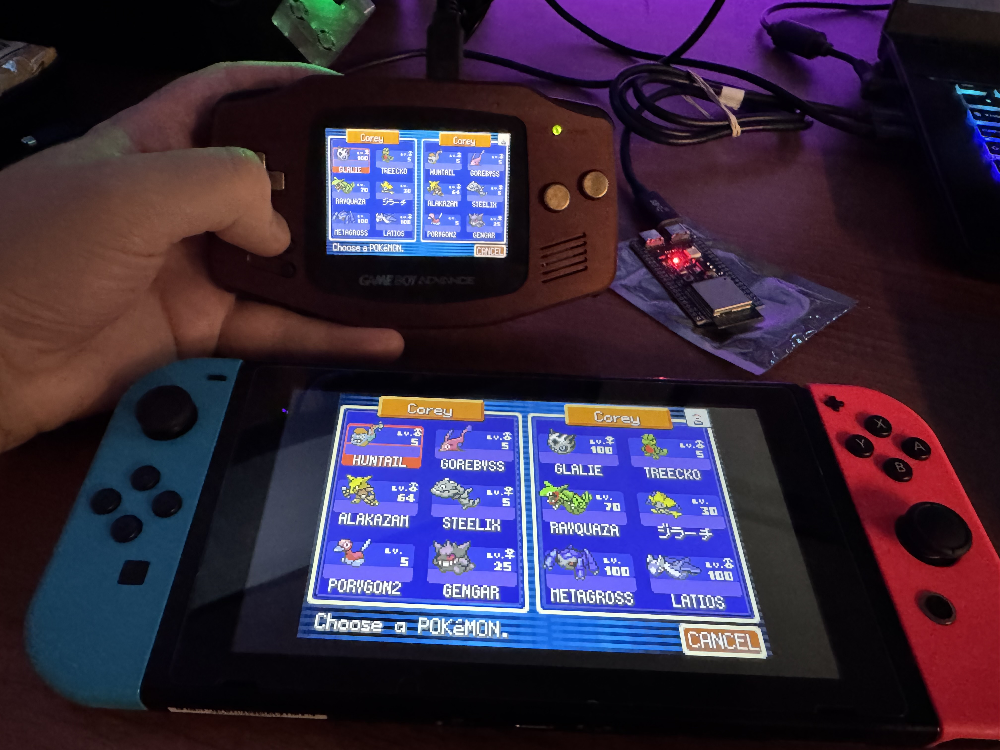
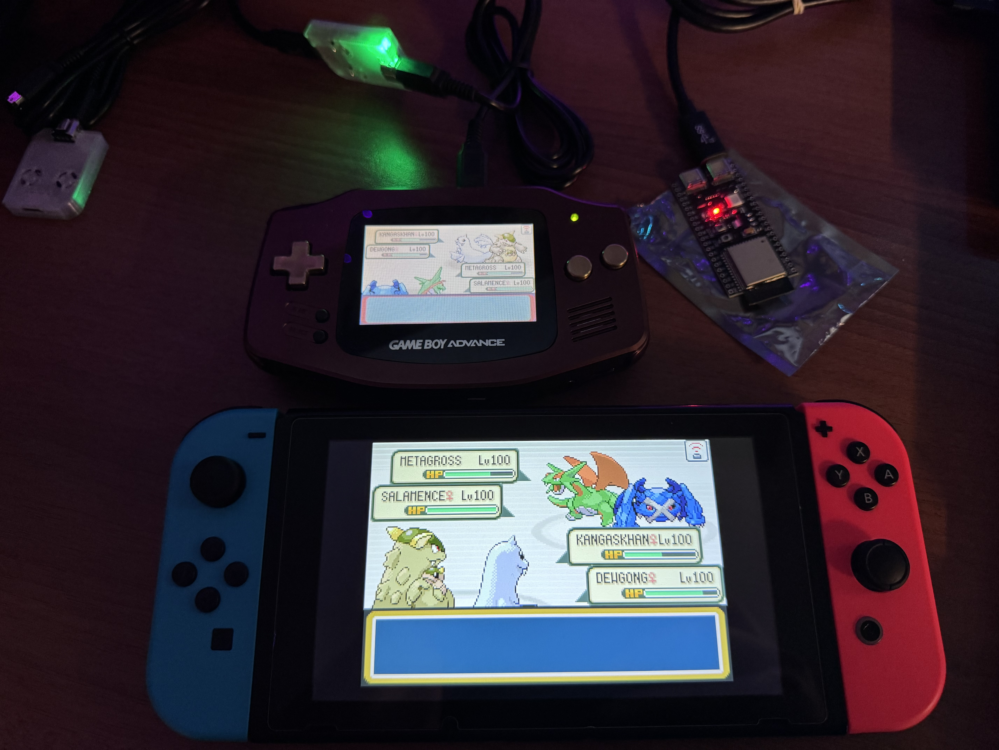
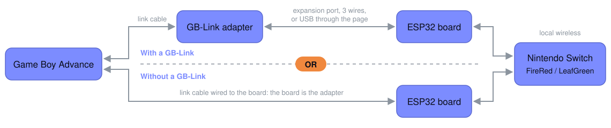
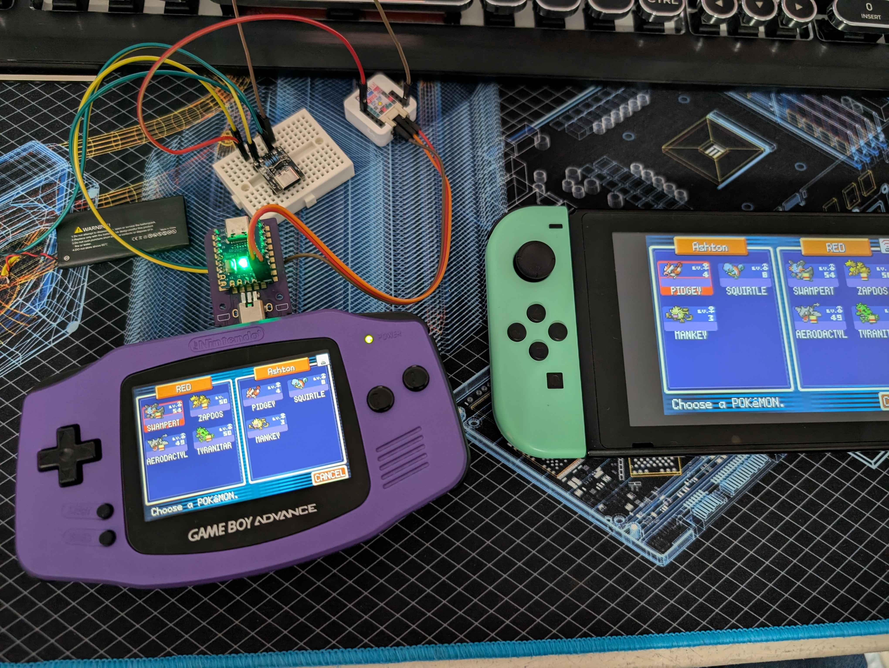

# GB-Link Switch LDN

Trade and battle with Pokémon FireRed and LeafGreen on the Nintendo Switch, from a real
Game Boy Advance, from a game played in your browser, or from your PC.

- **GBA to Switch.** A GBA running FireRed, LeafGreen or Emerald joins the Switch's
  Trade Center or Colosseum over the Switch's own local wireless, as if it were another
  Switch. Trades and battles. Ruby and Sapphire, which have no wireless, trade and battle
  too: the web page links them by cable and turns that link into the Switch's wireless.
- **Play in your browser.** The web page has a Game Boy Advance emulator of its own. Ruby,
  Sapphire, Emerald, FireRed or LeafGreen played in it trades and battles with the Switch
  just like a real GBA, and you need only the ESP32 board.
- **Online with Celio.** Trade and battle over the internet with anyone on
  [Celio](https://celio.gblink.io/): your Switch with their Game Boy Advance
  (Ruby, Sapphire, Emerald, FireRed or LeafGreen on a GB-Link or in an emulator), or with
  another Switch through this page. You need only the ESP32 board.
- **PC to Switch.** Only have a Switch? All you need is an ESP32 board, no GBA and no
  GB-Link. Trade with the Switch from the web page, from an online Wonder Trade pool or
  from your own `.pk3` files.
- **Mystery Gift.** Send Wonder Cards to the Switch from the web page: Nintendo's FireRed
  and LeafGreen event distributions, the Project Wonder events, and the GB-Link Team's
  cards (speed up or slow down, event Pokémon, Espeon and Umbreon, HM moves without HMs,
  the Physical/Special split, the Pocket Casino and more). You need only the ESP32 board.
- **Save backup and restore.** The same Mystery Gift link copies the Switch's FireRed or
  LeafGreen save to the page as a `.sav` file, or writes a `.sav` back.

Everything is set up and played from **<https://switch.gblink.io>**.

|  |  |
| --- | --- |
| Trading | Battling |

Emerald on a GBA against FireRed on a Switch. Photos by AngeloftheNight091.

## How it works

The Switch's local wireless is a Wi-Fi network. An ESP32 board joins it the way a
second Switch would. On the GBA side, a [GB-Link](https://github.com/GB-Link/GBLink-Firmware)
adapter in the link port stands in for the Wireless Adapter. The two boards are
connected with three wires, or both go on USB and the web page passes the traffic
between them.

Standalone: the GB-Link in the link port, three wires to the ESP32, a battery, and no
computer.

## What you need

**GBA to Switch** needs an ESP32 board and a GB-Link adapter. **Play in your browser**,
**PC to Switch** and **Mystery Gift** need only the ESP32 board.

- An ESP32 board. The ESP32-S3 is the recommended one.

  | Chip | Connects over |
  | --- | --- |
  | ESP32 (original) | USB-to-UART chip, 921600 baud |
  | ESP32-S3 | native USB |
  | ESP32-C6 | native USB |
  | ESP32-C5 | native USB |
  | ESP32-C3 | native USB |

- A Switch with FireRed or LeafGreen, and the `prod.keys` file from your Switch. The
  board needs four keys from it to talk to the Switch. The page sends them to the board
  over USB; nothing is uploaded anywhere.
- For GBA to Switch: a GB-Link adapter, a **Game Boy Color link cable** (a Game Boy
  Advance cable will not work) and a GBA with FireRed, LeafGreen or Emerald. Between
  Emerald and the Switch's game, the games allow trades only once both players have
  entered the Hall of Fame and the Switch player has finished the Sevii Islands story
  (Cerulean Cave shows on its town map), just like between two GBAs. When the page
  carries the link, turning on its National Dex bypass lets them trade anyway.
- For Play in your browser: the game's ROM, dumped from your own cartridge (Ruby,
  Sapphire, Emerald, FireRed or LeafGreen, any language and revision), and its save if you
  have one.

## Setting up

Open the web client in Chrome or Edge on a computer. Phones and Safari cannot reach the
boards.

1. **ESP32 board.** Plug it in, press *Install firmware*, then drop your `prod.keys` on
   the page.
2. **GB-Link adapter.** Plug it in and install the wireless firmware. It connects to the
   GBA with a Game Boy Color cable. Skip this for PC to Switch.
3. **Play.** Connect the boards with three wires (the page shows which pins) and power
   them from anything, or leave both on USB and press *Start* so the page carries the
   link.

On the Switch, go upstairs in a Pokémon Center to the Direct Corner, pick Trade Center
or Colosseum and become the leader. On the GBA, pick the same thing and join the group.
The Switch shows up after a few seconds. When you leave the room the board is ready again
a few seconds later, or about ten seconds later when the page carries the link.

It also works the other way round: lead the group on the GBA, then join it from the
Switch.

Four-player multi battles work the same way, led from either side. A Switch can lead
with GBAs joining, or a GBA can lead with Switches joining; another GBA joins through its
own board. With a GBA leading four players the game runs a little slower than with a
Switch leading.

### Ruby and Sapphire

Pick *Ruby, Sapphire* in the Play step and press *Start*, with both boards on USB. Lead a
Trade Center or Colosseum (single or double battle) group on the Switch, then on the GBA
talk to the attendant upstairs in a Pokémon Center: the middle counter to trade, the left
one for the same kind of battle. The page joins the Switch's group once the GBA has
linked; accept the join on the Switch. The Switch always leads.

### Play in your browser

Pick *Play in this browser* at the top of the page, or open
<https://switch.gblink.io/#emu>. Drop the game's ROM on the page, with its `.sav` if you
have one. The page plays clean dumps of the cartridges only. The game and its save stay in
your browser for next time, and *Save file* downloads the save.

Arrow keys move, X is A, Z is B, A and S are L and R, Enter is Start and Space is Select.
A gamepad works too, and on a touch screen the buttons are on the screen.

Press *Start* in the link step, then play as on a real GBA: lead a group on the Switch and
join it from the game, or lead from the game and join from the Switch. FireRed,
LeafGreen and Emerald play with a Wireless Adapter plugged in. Ruby and Sapphire play as
in the section above: the Switch leads, and the page joins its group once the game has
linked at the Cable Club. Keep the tab open while you play.

### Online with Celio

Pick *Online with Celio* at the top of the page. Create a session and send its Session Id
to a Celio user, or join theirs; Game Boy Advance and emulator players connect at
<https://celio.gblink.io/>, another Switch player uses this page. Press
*Start* once they have joined. Whoever presses *Start* first leads: if that is you, lead a
group on the Switch; otherwise the page opens a group for the Switch to join and asks which
room the Switch goes to. The other player talks to their Cable Club attendant for the same
room. Leaving the room on both consoles ends the session. Sessions are for two players.

### PC to Switch

Pick it at the top of the page, or open <https://switch.gblink.io/#switch>. Host a
Trade Center room on the Switch, press *Connect*, accept the join on the Switch and sit
down at the table.

- **Wonder Trade.** The pool picks the Pokémon you get, and what the Switch gives goes
  into the pool for the next person. <https://pokemon.gblink.io/pool> shows what is in
  it. Leave the table and sit down again for a different one.
- **PK3 files.** Your own party, kept in the browser. Pokémon go in and out as `.pk3`
  files, and what the Switch sends takes the place of what you gave.

Keep the tab in view while you trade; a hidden tab runs too slowly for the game.

The desktop app in [`host/`](host/README.md) trades from a party of your own on Windows
and Linux.

### Mystery Gift

Pick it at the top of the page, or open <https://switch.gblink.io/#gift>. Choose a Wonder
Card and press *Start*. On the Switch, pick MYSTERY GIFT on the game's main menu, then
WONDER CARDS, then FRIEND, and choose GBLINK from the list. Once the card is saved, talk
to the deliveryman upstairs in any Pokémon Center. The page stays ready for the next card,
on the same Switch or another one.

Your own Wonder Cards go the same way: drop a `.wc3` file on the Mystery Gift card, or
click it to choose one. Only cards made for FireRed or LeafGreen work on the Switch, such
as the `FL - …` files in Project Pokémon's
[event gallery](https://github.com/projectpokemon/EventsGallery).

#### Backing up and restoring the save

*Back up the save* and *Restore a save* sit at the end of the list. They go the same way as
a card. A backup copies the whole 128 KB save to the page, which offers it as a `.sav` file
for PKHeX or an emulator; the game shows a message and saves nothing. A restore puts the
chosen `.sav` into the game, checks that all of it arrived intact, then lets the game load
and save it. If anything is wrong, or the link drops halfway, the game keeps the save it
had. Either takes one to four minutes, depending on how much of the save is empty.

MYSTERY GIFT shows on the main menu once the game has it unlocked: answer a Poké Mart
questionnaire with LINK TOGETHER WITH ALL, then save.

On a Game Boy Advance these cards arrive through WIRELESS COMMUNICATION, from a store
kiosk. On the Switch that option only accepts a kiosk, so the page sends its cards the way a
friend would, through FRIEND. The cards work the same either way.

The GB-Link Team's cards are built for the Switch's FireRed and LeafGreen in English,
French, German, Italian and Spanish; see [`cards/`](cards/README.md).

## Repository layout

| Directory | Contents |
| --- | --- |
| [`web`](web/README.md) | The web page |
| [`emulator`](emulator/README.md) | The web page's Game Boy Advance emulator |
| [`firmware`](firmware/README.md) | The ESP32 firmware |
| [`host`](host/README.md) | The desktop app, in C# |
| [`cards`](cards/README.md) | The GB-Link Team's Wonder Cards, built for the Switch's games |

## Building

Nothing needs building to play: the web page installs prebuilt firmware. To build it
yourself, see [`firmware/README.md`](firmware/README.md). The adapter firmware comes
from [GBLink-Firmware](https://github.com/GB-Link/GBLink-Firmware). The page's emulator is
prebuilt in `web/emulator/`; [`emulator/README.md`](emulator/README.md) rebuilds it.

## Credits

The ESP32's LDN code started from [easyworld/frlg-ldn-trade-esp32](https://github.com/easyworld/frlg-ldn-trade-esp32),
a port of [tornadus/frlg-ldn-trade](https://github.com/tornadus/frlg-ldn-trade). Photos by
AngeloftheNight091. Pokémon pictures on the page come from [PokeAPI](https://github.com/PokeAPI/sprites).
The Mystery Gift cards and their link code come from
[gblink-wondercards](https://github.com/GB-Link/gblink-wondercards); the Pocket Casino card
is by RAF. The Switch's side of Mystery Gift, the FRIEND path and its timing follow
Decryptu's [pokeldn](https://github.com/Decryptu/pokeldn). The page's emulator is
[mGBA](https://mgba.io).

## Licence

AGPL-3.0, see `LICENSE`. The LDN protocol components are GPL-3.0
(`licenses/LDN-GPL-3.0.txt`), and so are `cards/` and the Mystery Gift code in `web/js/gift/`,
which come from gblink-wondercards. The web client bundles
[esptool-js](https://github.com/espressif/esptool-js) (Apache-2.0),
[picoflash](https://github.com/picoflash/picoflash) (MIT) and
[mGBA](https://mgba.io) (MPL-2.0, `web/emulator/LICENSE-mGBA.txt`). `local`, `prod.keys`,
`title.keys` and build outputs are ignored by git. Not affiliated with Nintendo or The
Pokémon Company.
