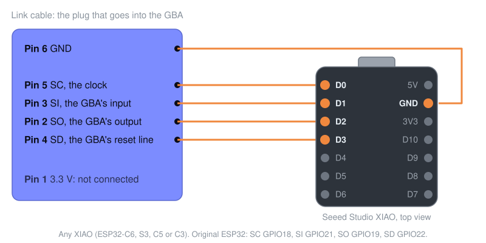

# Bridge firmware

Firmware for the ESP32 board. It joins the Switch's local wireless like a second Switch
(or hosts the room when the GBA leads) and passes the game's traffic to the GBA: through
a GB-Link adapter running the wireless adapter mode, or with the GBA's link port wired to
the board, which is then the wireless adapter itself. Once flashed and given its keys, it
needs no computer.

The [web client](../web/README.md) installs it and stores the keys, so most people never
need this page.

## Boards

One firmware builds for five chips. The
[Seeed Studio XIAO ESP32-C6](https://www.seeedstudio.com/Seeed-Studio-XIAO-ESP32C6-Pre-Soldered-p-6328.html)
is the recommended one. Every chip uses
the pins of a Seeed Studio XIAO, so any XIAO fits the same wiring: D8 and D9 for a
GB-Link, D0 to D3 for the GBA's link port.

| Chip | Console | To a GB-Link's GP9 | To a GB-Link's GP8 | Link port SC, SI, SO, SD |
| --- | --- | --- | --- | --- |
| ESP32-S3 | native USB | D9 (GPIO8) | D8 (GPIO7) | D0 to D3 (GPIO1, 2, 3, 4) |
| ESP32-C6 | native USB | D9 (GPIO20) | D8 (GPIO19) | D0 to D3 (GPIO0, 1, 2, 21) |
| ESP32-C5 | native USB | D9 (GPIO9) | D8 (GPIO8) | D0 to D3 (GPIO1, 0, 25, 7) |
| ESP32-C3 | native USB | D9 (GPIO9) | D8 (GPIO8) | D0 to D3 (GPIO2, 3, 4, 5) |
| ESP32 | USB-UART chip, 921600 baud | GPIO17 (TX2) | GPIO16 (RX2) | GPIO18, 21, 19, 22 |

Other boards set their pins under `menuconfig`, "LDN bridge" and "GBA wireless adapter".

Tested boards: Seeed Studio XIAO ESP32-S3 (attach its antenna), ESP32-S3-N16R8,
M5Stack AtomS3, Seeed Studio XIAO ESP32-C6, a DOIT ESP32 DEVKIT V1 and an ESP32-C3
board. When it starts, the XIAO ESP32-C6 tries its onboard and external antennas on the
Wi-Fi traffic around it and keeps the one that hears it better, so an antenna plugged into
its U.FL socket is used without a setting. `LDN_ANTENNA 0|1` picks one by hand. The Seeed
Studio XIAO ESP32-C5 has no onboard antenna: attach its external one.

## With a GB-Link

Plug a XIAO into the GB-Link USB V2's expansion port, or wire D8 to the GB-Link's GP8, D9 to
its GP9 and ground to ground. The board finds the GB-Link on its own, whichever of the two
powers up first, and the GB-Link becomes the adapter. To use the board's USB as well (its
console, or the web page), plug that in before the GB-Link: a computer may not see a board
the GB-Link already powers.

If the link stays silent, the two data wires are probably swapped: `LDN_PICO_SWAP` swaps
them in software until the next restart.

## Wired to the GBA

Without a GB-Link, wire the GBA's link port to D0 to D3 and the board is the wireless
adapter. Count the pins at the plug that goes into the GBA. A link cable crosses SO and
SI between its two ends. The [main README](../README.md#with-only-an-esp32-board) has
photos of a XIAO on a cut link cable and notes on which cables work.



| GBA link port | Line | XIAO | Original ESP32 |
| --- | --- | --- | --- |
| 2 | SO, the GBA's output | D2 | GPIO19 |
| 3 | SI, the GBA's input | D1 | GPIO21 |
| 4 | SD, the GBA's reset line | D3 | GPIO22 |
| 5 | SC, the clock | D0 | GPIO18 |
| 6 | GND | GND | GND |

- Do not power the board from pin 1 (the GBA's 3.3 V). The board runs from its own USB.
- The port runs at 3.3 V while a GBA game is running. A Game Boy or Game Boy Color
  cartridge switches it to 5 V, which the board's pins do not tolerate. Only GBA games
  use the wireless adapter, so keep the board off the port otherwise.
- A 100 to 220 Ω resistor in series with SI and with SC (the two lines the board drives)
  is optional protection.
- Opening or closing the USB console can reset the board, and the adapter with it: a GBA
  using the adapter at that moment gets a link error. Keep the page connected through a
  session.
- The XIAO ESP32-C6 has the most memory for this setup. On an original ESP32, hosting a
  room (GBA leads) may not fit; on an ESP32-S3, hosting a four-player battle has not been
  tried yet.
- The ESP32-C3 and C5 have not been tried wired to a GBA yet. On both, some of D0 to D3
  are pins the chip reads as it starts. If the board does not start with the GBA
  connected, start it first and plug the cable in afterwards.

At boot the console shows the adapter's self-test:

    LDN_WA adapter on SC 0 SO 2 SI 1 SD 21, self-test passed: mode 3, ...

## Building

The build is pinned to ESP-IDF v6.1 (commit `fff9895c82d744c7237be8847347bdd1b07c6643`),
because the firmware uses a private part of the Wi-Fi driver.

```
tools/build.sh ESP32-S3
tools/build.sh ESP32-S3 flash /dev/ttyACM0
```

Each chip builds in `build/<chip>`. To flash with another tool, write these three files
from it:

| Address | File |
| --- | --- |
| `0x0` (`0x1000` on the original ESP32) | `bootloader/bootloader.bin` |
| `0x8000` | `partition_table/partition-table.bin` |
| `0x10000` | `ldn_bridge.bin` |

`tools/package_web.py` copies the built images into the web client.

## Keys

The board needs four keys from your Switch's `prod.keys`. They are stored on the board,
not in the firmware, and survive reflashing (but not a full erase). The web client sends
them for you; by hand:

```
LDN_KEY aes_kek_generation_source <32 hex>
LDN_KEY aes_key_generation_source <32 hex>
LDN_KEY master_key_00 <32 hex>
LDN_KEY master_key_12 <32 hex>
LDN_KEYS
```

`LDN_KEYS` shows which keys are stored. It never prints them.

## How it works

- The board only joins or hosts a room while it has a GBA to link, so a board that is just
  plugged into a PC stays out of the way. It joins a Switch's room only while the GBA's
  player looks for one (JOIN GROUP, or the Union Room), and leaves when the player stops
  looking without joining. With older GB-Link firmware, which does not report that, the
  board joins a FireRed room as soon as it finds one.
- **Switch leads:** the board joins the Switch's room and shows it to the GBA as a
  wireless group.
- **GBA leads:** the board hosts a room that looks like a Switch's, and the Switches
  join it: one for a trade or a two-player battle, up to three for a multi battle.
- **Union Room:** works both ways. The GBA's player shows up in the Switch's Union Room
  and the Switch's player in the GBA's, and either side can start an activity: trainer
  cards, trades, the trading board, battles and chat.
- The link between the two games is lockstep and the wireless adds lag, so
  `trade_shim.c` smooths over the differences: the Switch version runs one extra
  standby step after a trade, lost messages are resent, and old d-pad reports are
  dropped when they pile up so walking stays responsive.
- When a session ends, the board is ready again within a few seconds. When the web client
  carries the adapter over USB, the board restarts instead and is ready again in about ten
  seconds.

## Console commands

| Command | |
| --- | --- |
| `LDN_INFO` | firmware version and chip |
| `LDN_STATUS`, `LDN_BRIDGE_STATUS` | link state and counters |
| `LDN_SHIM_LOG` | log of the last sessions, kept across restarts |
| `LDN_RF` | signal strength of the room |
| `LDN_PICO_STATUS`, `LDN_PICO_PROBE`, `LDN_PICO_SWAP` | the wires to the GB-Link, or the board's own adapter |
| `LDN_PICO_BOOTSEL` | restart the GB-Link into its bootloader for reflashing |
| `LDN_BRIDGE_STOP`, `LDN_BRIDGE_START` | stop or start the bridge |
| `LDN_ADAPTER host\|uart` | adapter on the wires, or carried over USB by the web client |

Some serial tools reset the board when they open the port (DTR). Open it with DTR high
and RTS low. The original ESP32's console runs at 921600 baud.

## Troubleshooting

- **The GBA freezes when the game starts the wireless adapter.** Use a Game Boy Color
  link cable; a Game Boy Advance cable does not work in this mode. Update the adapter
  firmware, and if it still happens, try another cable.
- **The GBA says the trainer is busy, or waits forever.** Close the room on the Switch
  and open it again.
- **Emerald says the other trainer is not ready yet, or a game says it can't transmit
  with a trainer who is too far away.** Emerald and FireRed or LeafGreen trade only once
  both players have entered the Hall of Fame and the FireRed or LeafGreen player has
  finished the Sevii Islands story (Cerulean Cave shows on its town map). The same
  happens between two GBAs. When the web page carries the link, turning on its National
  Dex bypass lets them trade anyway.
- **The GBA never sees the Switch.** Check the keys (`LDN_KEYS`), the antenna, and that
  both consoles picked the same activity.
- **Choppy walking.** Move the board closer to the Switch.

## Licence

AGPL-3.0, see `LICENSE` at the repository root. The LDN protocol components are GPL-3.0
(`licenses/LDN-GPL-3.0.txt`).
